  

Estudiante de primer curso del Ciclo Formativo de Grado Superior en **Desarrollo de Aplicaciones Web** en Davante Medac Nova (Málaga). Programo en **Java**, maqueto en **HTML**, diseño bases de datos relacionales con **SQL** y actualmente estoy aprendiendo **Lua**. Mi objetivo profesional es especializarme en **inteligencia artificial** y **ciberseguridad**.

Busco **prácticas (FCT)** como desarrollador en Málaga o en remoto.

     

       

## Formación

**Técnico Superior en Desarrollo de Aplicaciones Web** · Davante Medac Nova, Málaga · 2026–2028 (cursando 1.º)

Competencias adquiridas hasta ahora en el ciclo:

- Maquetación de páginas web con HTML5.
- Programación en Java con estructuras de control.
- Diseño de bases de datos relacionales y consultas SQL.
- Instalación y configuración de sistemas operativos y máquinas virtuales.

## Experiencia

**Mosaic Factory** · Mozo de almacén · 2026 (2 meses)

- Preparación y envío de muestras personalizadas de mosaicos a clientes, con seguimiento de los envíos y de las valoraciones recibidas.
- Colaboración con el equipo de informática en el desarrollo de la base de datos de la empresa: propuesta de mejoras y pruebas de funcionamiento como tester.

## Proyectos

### [Mis tests de estudio](https://claude.ai/artifact/Uuz8SHFxgoL6TdPPrL6yZh)

Aplicación web que genera tests de tipo examen a partir de apuntes en PDF, Word o imagen, organizados por asignatura y tema. Registra los aciertos y fallos de cada intento y muestra estadísticas por tema para identificar qué contenidos necesitan repaso. La utilizo para preparar los módulos del ciclo, como Sistemas Informáticos, Bases de Datos o Entornos de Desarrollo.

Desarrollada con ayuda de IA

### [Agendado](https://agendado-kappa.vercel.app)

Plataforma web de reserva de citas para pequeños negocios como peluquerías, barberías o estudios de tatuaje. Cada negocio configura sus horarios, servicios y profesionales, y sus clientes solo pueden reservar en huecos realmente disponibles. Una restricción en la base de datos garantiza que no existan dos reservas solapadas para el mismo profesional, incluso si se realizan de forma simultánea. Incluye tres roles con permisos diferenciados (cliente, negocio y administrador), suscripciones de pago con Stripe y un código QR imprimible para cada negocio.

        

Desarrollada con ayuda de IA

## Uso de la inteligencia artificial

He desarrollado ambos proyectos con la ayuda de Claude. Mi trabajo ha consistido en definir los requisitos de cada aplicación, organizar el desarrollo por fases, probar cada funcionalidad y pedir explicaciones del código y de las decisiones técnicas hasta comprenderlas. Es el área en la que quiero especializarme profesionalmente.

## Otros conocimientos

- Linux y configuración de servidores de Discord, de forma autodidacta.
- Idiomas: español (nativo) e inglés (avanzado).

## Música

Lo que escucho mientras programo, conectado en tiempo real a mi cuenta de Spotify.

  

  

## Contacto

    

